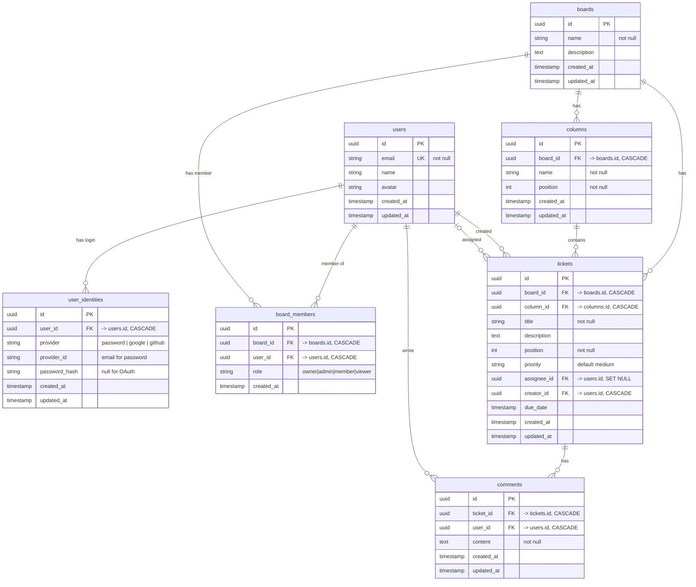
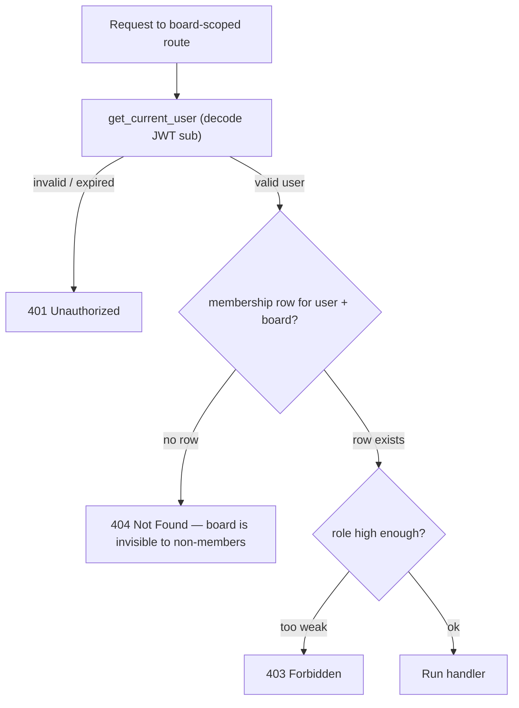

# TaskFlow — Database Schema

> **Source of truth:** the SQLAlchemy ORM models in `backend/app/database/models/`
> (one file per table). The schema is created on app startup by
> `Base.metadata.create_all` and populated by `app/seed.py`. There are **no raw
> SQL setup scripts** — this document is reference/rationale, kept in sync with
> the models by hand.
>
> **Full design rationale:** `docs/specs/authorization-data-model.md`.
> Preview the diagrams below in VS Code (Markdown preview + a Mermaid extension)
> or on GitHub, which render Mermaid natively.

---

## 1. Entity–relationship diagram

---

## 2. Tables

### `users`
Profile only — **no credentials live here.** Login secrets are in `user_identities`.

| column | type | notes |
|---|---|---|
| id | uuid PK | |
| email | varchar(255) | unique, not null |
| name | varchar(255) | nullable — set later via `PATCH /auth/me` |
| avatar | varchar(500) | |
| created_at / updated_at | timestamp | |

### `user_identities`
One row per login method a user has. Keeps auth separate from profile so new
providers (Google, GitHub, …) are new rows, not new columns on `users`.

| column | type | notes |
|---|---|---|
| id | uuid PK | |
| user_id | uuid FK → users.id | not null, `ON DELETE CASCADE` |
| provider | varchar(50) | `password` today; `google` / `github` later |
| provider_id | varchar(255) | email for password auth; provider `sub` for OAuth |
| password_hash | varchar(255) | bcrypt hash; **NULL for OAuth identities** |
| created_at / updated_at | timestamp | |

**Constraint:** `UNIQUE (provider, provider_id)` — the same external identity can't be registered twice.

### `boards`
Deliberately has **no `owner_id`** — ownership is a membership row (see Decision 1).

| column | type | notes |
|---|---|---|
| id | uuid PK | |
| name | varchar(255) | not null |
| description | text | |
| created_at / updated_at | timestamp | |

### `board_members` — the authorization table
The join table that grants access. Every board-scoped permission check is a
lookup here (see §3).

| column | type | notes |
|---|---|---|
| id | uuid PK | |
| board_id | uuid FK → boards.id | not null, `ON DELETE CASCADE` |
| user_id | uuid FK → users.id | not null, `ON DELETE CASCADE` |
| role | varchar(20) | not null, default `member` |
| created_at | timestamp | |

**Constraints & indexes:**
- `UNIQUE (board_id, user_id)` — one membership per user per board (no contradictory dual roles).
- `CHECK role IN ('owner','admin','member','viewer')` (`valid_board_role`).
- Partial unique index `one_owner_per_board` on `(board_id) WHERE role = 'owner'` — at most one owner.

### `columns`
Kanban columns, ordered within a board by `position`. (Model class is
`BoardColumn`; table name is `columns`.)

| column | type | notes |
|---|---|---|
| id | uuid PK | |
| board_id | uuid FK → boards.id | not null, `ON DELETE CASCADE` |
| name | varchar(255) | not null |
| position | integer | not null |
| created_at / updated_at | timestamp | |

### `tickets`

| column | type | notes |
|---|---|---|
| id | uuid PK | |
| board_id | uuid FK → boards.id | not null, `ON DELETE CASCADE` |
| column_id | uuid FK → columns.id | not null, `ON DELETE CASCADE` |
| title | varchar(500) | not null |
| description | text | |
| position | integer | not null — ordering within a column |
| priority | varchar(50) | default `medium` |
| assignee_id | uuid FK → users.id | nullable, `ON DELETE SET NULL` |
| creator_id | uuid FK → users.id | not null, `ON DELETE CASCADE` ⚠️ (see §4) |
| due_date | timestamp | |
| created_at / updated_at | timestamp | |

### `comments`

| column | type | notes |
|---|---|---|
| id | uuid PK | |
| ticket_id | uuid FK → tickets.id | not null, `ON DELETE CASCADE` |
| user_id | uuid FK → users.id | not null, `ON DELETE CASCADE` ⚠️ (see §4) |
| content | text | not null |
| created_at / updated_at | timestamp | |

---

## 3. Authorization model

Access is granted **only** through `board_members`. Every board-scoped request
resolves to the same question, checked live on each request:

> Fetch the `board_members` row for `(current_user, board)`.
> No row → treat as **404**. Otherwise read `role` and check it against the action.

This is written once as `require_board_role(min_role)` and declared by every
board route; handlers re-*invoke* it, they never re-implement it. Because it
depends on `get_current_user`, FastAPI resolves **auth → authz → handler**
automatically.

### Permission matrix

| Action | owner | admin | member | viewer |
|---|:--:|:--:|:--:|:--:|
| View board / tickets / comments | ✅ | ✅ | ✅ | ✅ |
| Create / edit / move / delete tickets | ✅ | ✅ | ✅ | ❌ |
| Create / edit / delete columns | ✅ | ✅ | ✅ | ❌ |
| Comment | ✅ | ✅ | ✅ | ❌ |
| Add / remove members, change roles | ✅ | ✅ | ❌ | ❌ |
| Rename / edit board settings | ✅ | ✅ | ❌ | ❌ |
| Delete board, transfer ownership | ✅ | ❌ | ❌ | ❌ |

---

## 4. Core design decisions (why the schema looks like this)

### D1 — `board_members` is the single source of truth for access; `boards` has no `owner_id`
Ownership is `role = 'owner'` on a membership row, not a column on `boards`.
- **Why:** one place to get authz right — every check is the *same* lookup
  against *one* table — and the data can't contradict itself (no "`owner_id`
  says Alice but her membership says viewer").
- **The trade:** a `NOT NULL owner_id` gave "exactly one owner" for free; a join
  row gives that up, so we buy it back:
  - *at most one owner* → partial unique index `one_owner_per_board`;
  - *at least one owner* → **application invariant**: the owner's membership is
    inserted in the *same transaction* as the board, and the system refuses to
    delete/demote the last owner.

### D2 — reads require membership; non-members get `404`, not `403`
A missing membership row is indistinguishable from a missing board to the caller.
This keeps a board's existence private (no enumeration) and means there is **one**
access rule, not a separate "public read" path.

### D3 — `role` is a constrained set, not free text
Free-text roles allow `'amdin'`, `'Owner'`, `'superuser'` — each silently breaks
authz differently. A `CHECK` constraint pins `role` to the four known values in
the table itself, so no application bug can persist a garbage role. (A native
Postgres `ENUM` or a `roles` lookup table are heavier alternatives, reserved for
if roles later need to carry their own permission flags.)

### D4 — authorization is checked live per request, not baked into the token
Authentication ("who are you?") is proven once at login and carried in the JWT.
Authorization ("may *you* do *this* to *this* board?") is a per-resource question
the token can't answer, so it's checked live against `board_members` on every
request. Checking live means a **demotion or removal takes effect immediately** —
role is deliberately kept *out* of the JWT to avoid stale privileges.

### D5 — separate credentials from profile (`user_identities`)
Keeping login secrets in their own table (rather than columns on `users`) means
adding OAuth providers is additive — a new `user_identities` row with a NULL
`password_hash` — and the `users` profile table never mixes concerns.

### D6 — UUID primary keys everywhere
Non-guessable IDs (no enumeration of boards/tickets by incrementing an integer),
and IDs can be generated app-side without a round-trip. Trade-off: 16 bytes vs 4,
and random UUIDs aren't time-ordered (a future move to UUIDv7/ULID is noted in
the spec for index locality at scale).

### D7 — UUIDs generated in Python (`default=uuid.uuid4`), not by the DB
The ORM is the single source of truth for schema and defaults, consistent with
the "no raw SQL / no Alembic during MVP" stance — schema is `create_all`, reset
via `docker compose down -v`.

---

## 5. Invariants (summary)

- Every board has **exactly one** `owner` membership (≤1 by index, ≥1 by app logic).
- A user has **at most one** membership per board.
- No access without a membership row — reads included.
- Deleting a board cascades to its members, columns, tickets, and (via tickets) comments.

---

## 6. Known drift / open items

- ⚠️ **`tickets.creator_id` and `comments.user_id` are `ON DELETE CASCADE`** in
  the models. That means deleting a user would delete every ticket they created
  and every comment they wrote. The spec left the user-deletion policy *TBD* and
  did **not** cascade these — this is worth reconciling (likely `SET NULL` +
  keep a "deleted user" placeholder, matching how `assignee_id` already uses
  `SET NULL`).
- **`backend/docs/schema.dbml`** (dbdiagram.io format) is hand-maintained and can lag
  the models; this file and it should be regenerated together when models change.
- **Open in the spec (§7):** role integrity mechanism (CHECK vs enum vs lookup),
  `priority` representation, whether `admin` can demote `owner`, invitations /
  pending memberships, and whether `user_identities` stays in scope.
