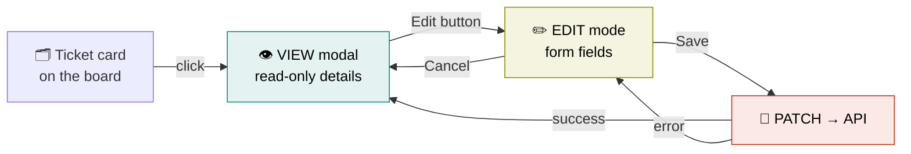
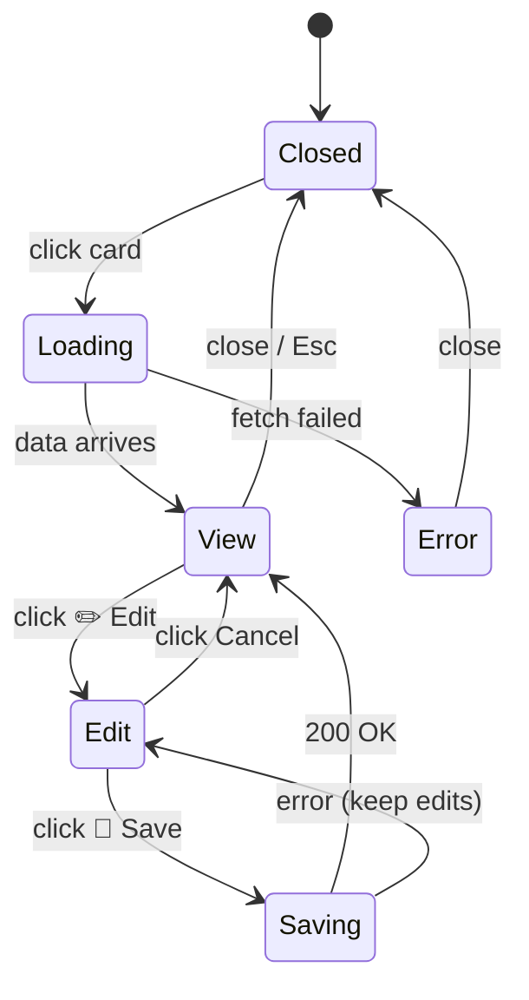
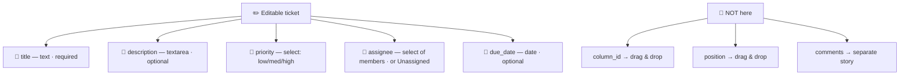
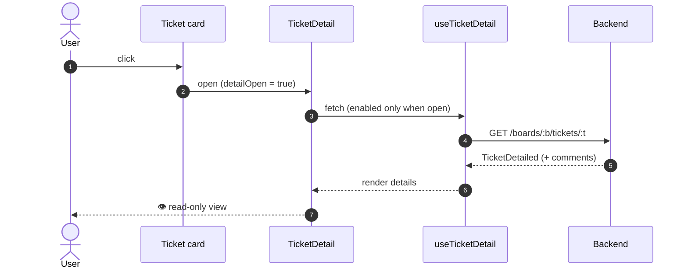
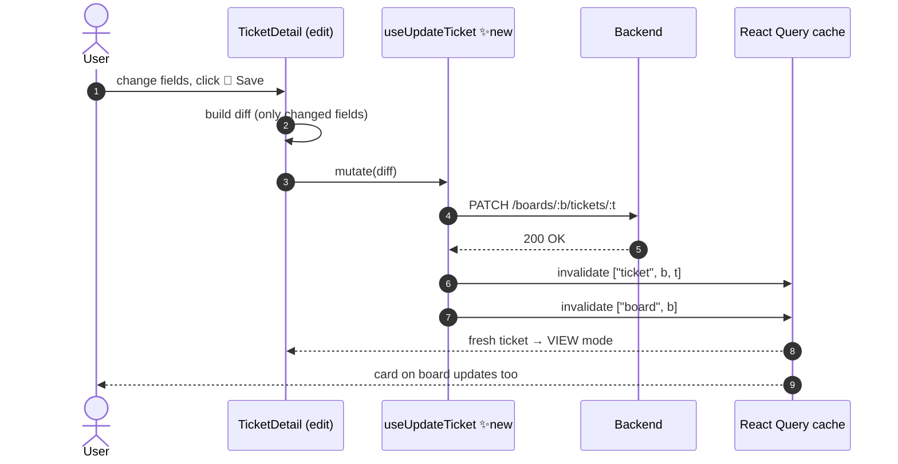
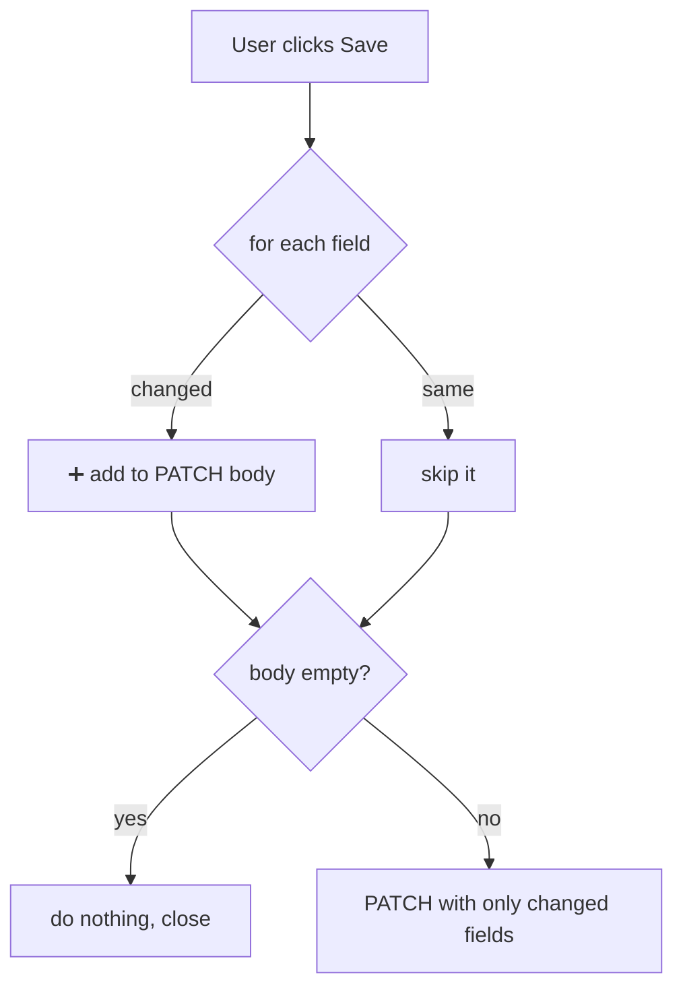
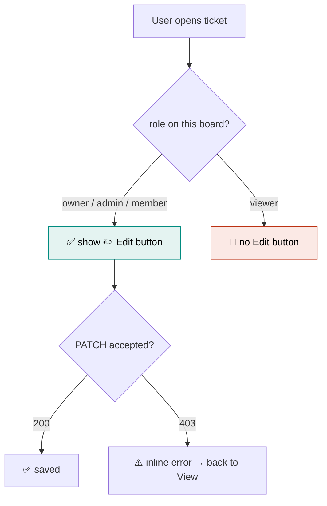
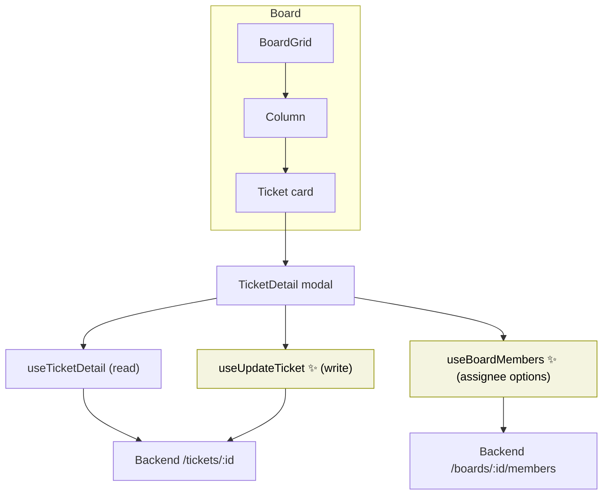

# 🎫 Ticket View & Edit — Spec

**Status:** 🟢 View shipped · 🟢 Edit shipped
**Author:** Micol · **Updated:** 2026-08-29

> **TL;DR** — Click a ticket → a modal opens with its full details (done ✅).
> Next: add an **Edit** mode to that same modal so members can change the
> title, description, priority, assignee, and due date. Backend already has the
> `PATCH` endpoint — this is frontend-only work.

---

## 1. The whole feature in one picture



**Two halves:**

| Half | State | What it does |
|------|-------|--------------|
| 👁️ **View** | ✅ Done | Opens a modal, shows everything read-only |
| ✏️ **Edit** | 🟡 To build | Turns the modal into a form, saves changes |

---

## 2. Modal states (view ↔ edit ↔ saving)



**Rules that matter:**
- 🔒 Modal **cannot close** while `Saving`.
- 💾 Save is **disabled** if the title is empty.
- ❌ On save error → back to `Edit` with the user's changes **intact** (never wipe input).

---

## 3. What you can edit

Only these five fields. Everything else (moving columns, position) stays with the
existing drag-and-drop + "move →" flow.



| Field | Control | Empty means |
|-------|---------|-------------|
| `title` | text input | ⛔ not allowed (required) |
| `description` | textarea | `null` |
| `priority` | select | always set |
| `assignee_id` | member dropdown | `null` (Unassigned) |
| `due_date` | date input | `null` |

---

## 4. Opening a ticket (VIEW — already built)



Already-shipped files:

| File | Job |
|------|-----|
| `pages/Board/TicketDetail.tsx` | The modal (read-only) |
| `hooks/useTicketDetail.ts` | `GET` the full ticket |
| `pages/Board/componets/Ticket.tsx` | Card click → opens modal |
| `types.ts` | `TicketDetailed`, `CommentType` |

---

## 5. Saving an edit (EDIT — to build)



**Why invalidate two things?**
- `["ticket", …]` → refreshes the **modal**.
- `["board", b]` → refreshes the **card** on the board (title/priority/assignee show there).

---

## 6. The "diff" — only send what changed



> 🎯 Sending only changed fields means we never overwrite something with a stale
> value we happened to be holding.

---

## 7. Who's allowed to edit?



- Backend **already enforces** `require_board_role(Role.MEMBER)` on `PATCH`.
- Frontend just **hides** the button for viewers + handles a 403 gracefully.

---

## 8. How the pieces connect



✨ = new to build. Everything else exists.

---

## 9. Build checklist

**New files**
- [ ] `hooks/useUpdateTicket.ts` — `PATCH` mutation (copy shape of `useMoveTicket.ts`)
- [ ] `hooks/useBoardMembers.ts` — `GET /boards/:id/members` for the assignee dropdown

**Edit `TicketDetail.tsx`**
- [ ] Add `mode` state: `"view" | "edit"`
- [ ] ✏️ Edit button (gated on role) → switch to edit mode
- [ ] Render form fields pre-filled from the ticket
- [ ] 💾 Save (diff + mutate) · Cancel (discard) footer
- [ ] Disable Save when title empty; pending state while saving
- [ ] Inline error on failure, keep edits

**Behaviour**
- [ ] After save: modal + board card both update
- [ ] Viewers never see Edit; 403 handled

---

## 10. Acceptance criteria

### 👁️ View (done — don't regress)
- [x] Click card → modal opens
- [x] Shows title, description, priority, assignee, reporter, due date, comments
- [x] "move →" and drag-and-drop still work, don't open modal

### ✏️ Edit (new)
- [ ] Edit button shows for member/admin/owner only
- [ ] Fields pre-fill correctly
- [ ] Only changed fields sent in `PATCH`
- [ ] Save persists and returns to View
- [ ] Modal **and** board card reflect new values
- [ ] Cancel discards
- [ ] Empty title disables Save; Save shows pending
- [ ] Failed save → inline error, edits preserved
- [ ] Viewer sees no Edit button; 403 handled

---

## 11. Open questions 🤔

1. **Assignee list** — build `useBoardMembers`, or does a members query already exist?
2. **Optimistic updates?** — start with invalidate-on-success (simpler); add optimism only if it feels slow.
3. **Delete ticket** — endpoint exists; add a guarded "Delete" to this modal as a follow-up?

---

## 📎 Reference: field → API mapping

`PATCH /api/boards/{board_id}/tickets/{ticket_id}` — body uses the existing
`TicketUpdate` schema (all fields optional):

```jsonc
{
  "title":       "string",      // required if present, non-empty
  "description": "string|null",
  "priority":    "low|medium|high",
  "assignee_id": "uuid|null",
  "due_date":    "ISO datetime|null"
  // column_id / position: NOT set from this UI
}
```
