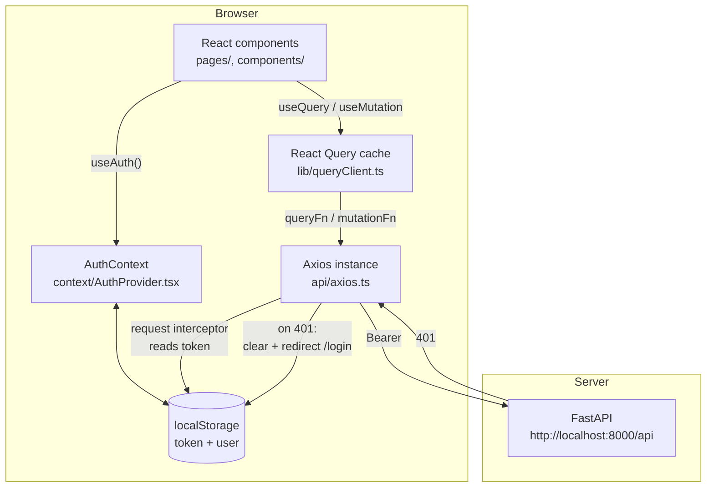
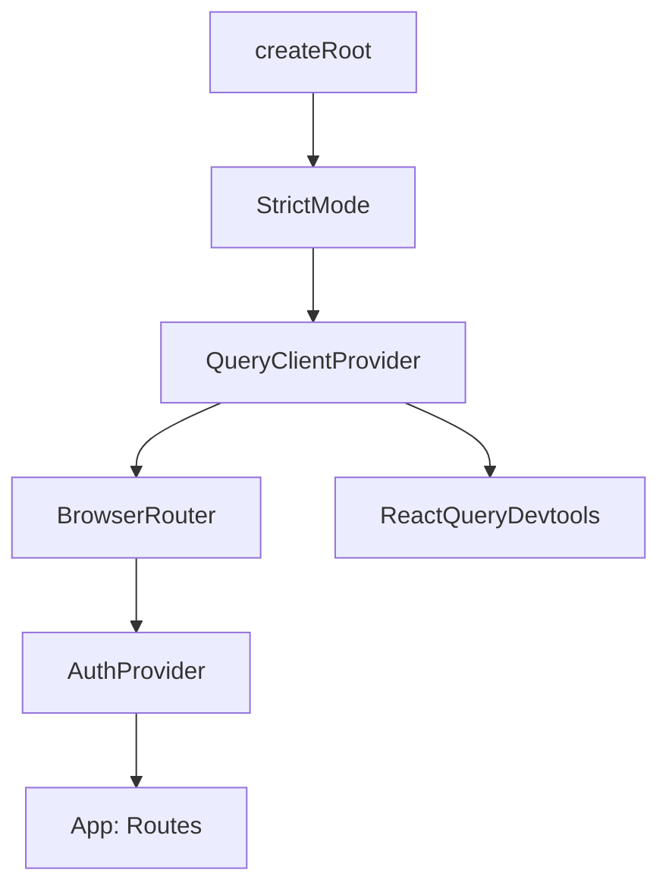
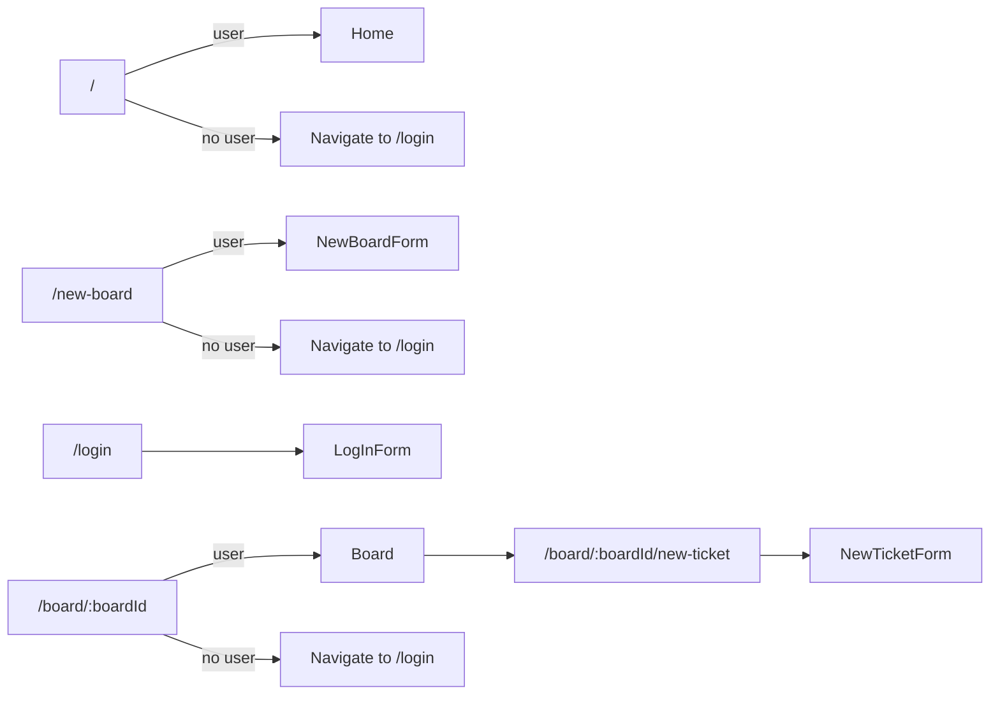
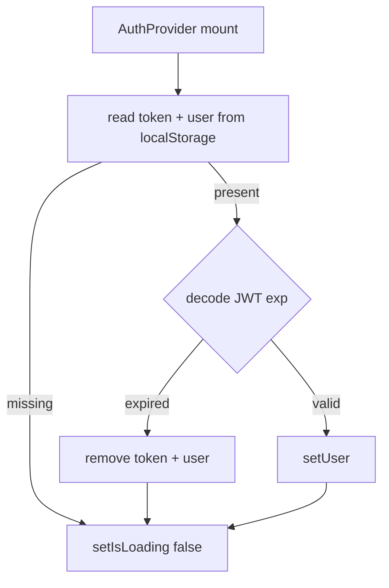
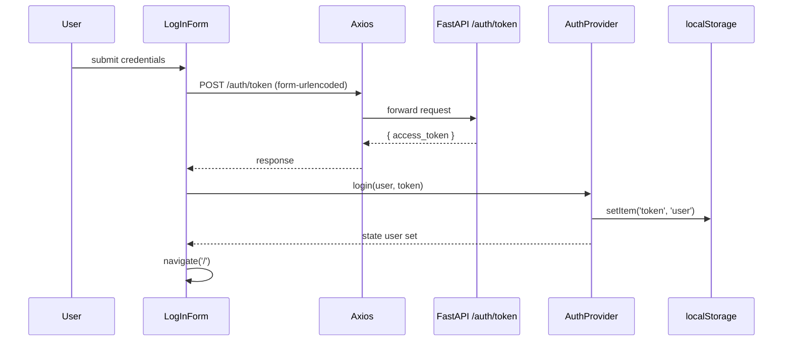
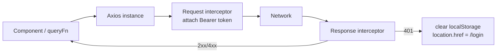
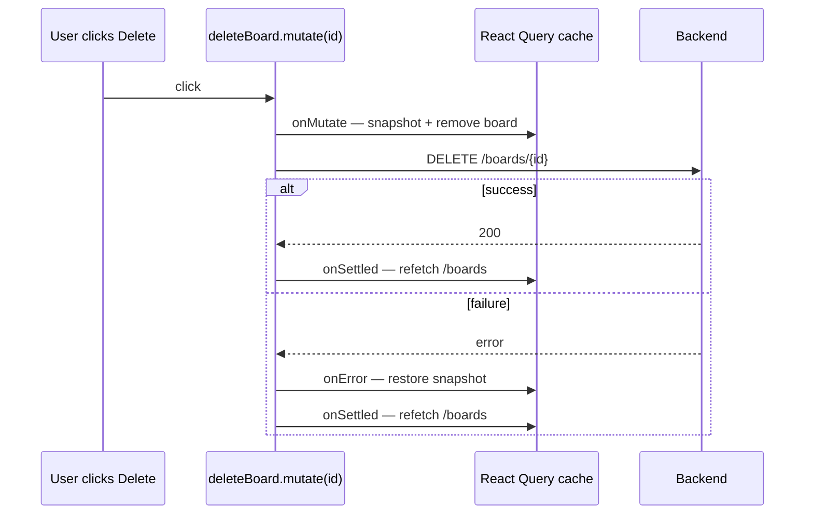
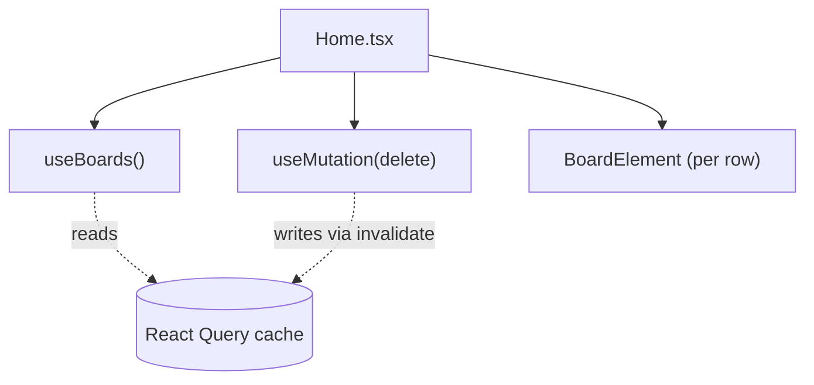
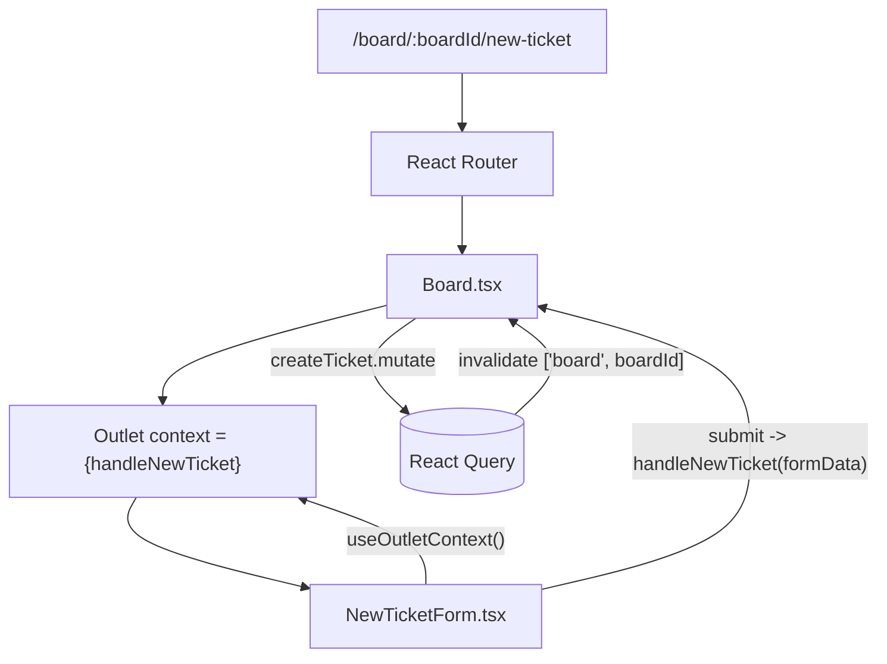

# Frontend Architecture — A Step-by-Step Walkthrough

This is a guided tour of the TaskFlow frontend. The goal is that by the end you can open any file in `src/` and know exactly what role it plays. We start at the moment the browser loads `index.html` and follow the code outward until every layer has been introduced.

For styling specifics, see [`ui-system.md`](./ui-system.md).

---

## 0. What we're building, at one glance

A single-page React app that talks to a FastAPI backend over JWT-authenticated REST. Users log in, see a list of boards, open a board, and move tickets between columns.



Three pieces of state, each in the cheapest place that works:

| Kind of state | Lives in | Example |
|---|---|---|
| Server data | React Query cache | board list, ticket list |
| Auth | React Context | current `user`, `login()`, `logout()` |
| Local UI | `useState` in the component | form inputs, dropdown open/closed |

The rest of the document explains how each of those pieces was wired up.

---

## 1. Bootstrap: from `index.html` to first paint

Vite serves `index.html`, which loads `src/main.tsx`. That file does one job: mount React with the right providers wrapped around `<App />`.

```tsx
// src/main.tsx
createRoot(document.getElementById("root")!).render(
  <StrictMode>
    <QueryClientProvider client={queryClient}>
      <BrowserRouter>
        <AuthProvider>
          <App />
        </AuthProvider>
      </BrowserRouter>
      <ReactQueryDevtools initialIsOpen={false} />
    </QueryClientProvider>
  </StrictMode>
);
```

Read this stack from the outside in — each provider can only consume context from providers *above* it.



Why this exact order:

1. **`StrictMode`** — dev-only. Doubles up effect runs so we catch unsafe patterns (e.g. an effect that doesn't clean up). It's outermost so it sees everything.
2. **`QueryClientProvider`** — owns the React Query cache. It wraps routing so the cache survives route changes. `ReactQueryDevtools` sits as a sibling of `BrowserRouter` because it only needs the client, not routing.
3. **`BrowserRouter`** — provides `useNavigate`, `useParams`, etc. We put it inside `QueryClientProvider` and outside `AuthProvider` so the auth layer is free to call `useNavigate` later if we want.
4. **`AuthProvider`** — exposes `user`, `login`, `logout`, `isLoading`. Sits closest to `App` so every page can `useAuth()` synchronously.

If you ever add a new global provider, this is the file to edit, and "what does this provider need to read?" tells you where in the stack it belongs.

---

## 2. Routing and the auth gate

`App.tsx` is where the URL meets a page. Three things happen here:

1. We pull `user` and `isLoading` out of context.
2. While `isLoading` is true, we render a placeholder. This avoids a "logged-out flash" during the first paint, before `AuthProvider` has finished reading localStorage.
3. We render `<Routes>` with each protected route inline-gated.

```tsx
// src/App.tsx
const { user, isLoading, login } = useAuth();

if (isLoading) return <div>Loading...</div>;

return (
  <Routes>
    <Route path="/" element={user ? <Home /> : <Navigate to="/login" replace />} />
    <Route path="/new-board" element={user ? <NewBoardForm /> : <Navigate to="/login" replace />} />
    <Route path="/login" element={<LogInForm handleLogIn={handleLogIn} />} />
    <Route path="/board/:boardId" element={user ? <Board /> : <Navigate to="/login" replace />}>
      <Route path="new-ticket" element={<NewTicketForm />} />
    </Route>
  </Routes>
);
```



Two design choices worth pausing on:

**Inline gating instead of a `<ProtectedRoute>` wrapper.** We have four protected routes. A wrapper component would add indirection without removing meaningful duplication. The day we add role-based gating, the inline `user ? ... : ...` is the seam to refactor.

**`new-ticket` is a *nested* child of `/board/:boardId`.** The new-ticket form is rendered inside `<Board />` through React Router's `<Outlet />`, so the board can stay mounted underneath while the form is "open." This gives the form its own URL (and back-button entry) for free.

---

## 3. The auth lifecycle

Auth is JWT-based. The frontend stores both the token and a serialised user object in `localStorage` so a refresh doesn't log the user out.

Three paths to understand: **mount-time rehydration**, **login**, and **session loss (401)**.

### 3a. Mount-time rehydration

When `AuthProvider` mounts, its single effect reads from `localStorage` and decides whether the session is still good.

```tsx
// src/context/AuthProvider.tsx
useEffect(() => {
  const token = localStorage.getItem('token');
  const savedUser = localStorage.getItem('user');
  if (token && savedUser) {
    const { exp } = JSON.parse(atob(token.split('.')[1])); // decode JWT payload
    if (exp * 1000 > Date.now()) {
      setUser(JSON.parse(savedUser));
    } else {
      localStorage.removeItem('token');
      localStorage.removeItem('user');
    }
  }
  setIsLoading(false);
}, []);
```



Why decode the JWT client-side? Because it's *cheap correctness*: we skip a guaranteed-failing round trip when we already know the token is expired. The backend is still the source of truth — if a token expires mid-session, the Axios 401 interceptor catches it (see §4).

### 3b. Login

`LogInForm` is a controlled form (`useState` for `email` / `password`). On submit it calls `handleLogIn` from props. Today `App.tsx` passes a placeholder `handleLogIn` that sends mock credentials — that's a known TODO (§9).



`login()` itself is plain:

```tsx
const login = (user: UserType, token: string) => {
  localStorage.setItem('user', JSON.stringify(user));
  localStorage.setItem('token', token);
  setUser(user);
};
```

`logout()` is the mirror image: clear both keys, set `user` to `null`.

### 3c. Why `localStorage` for the JWT

It's the simplest path that works against a plain REST backend — no CSRF plumbing, no cookie wiring. The trade-off is XSS exposure (any script you accidentally inject could read the token). That's acceptable for a learning project; before going public the natural upgrade is an HttpOnly cookie set by the backend.

---

## 4. The HTTP layer: one Axios instance, two interceptors

Every request goes through the single instance in `src/api/axios.ts`. Two interceptors run on every request:

```tsx
// src/api/axios.ts
const instance = axios.create({
  baseURL: "http://localhost:8000/api",
  headers: { "Content-Type": "application/json" },
});

instance.interceptors.request.use((config) => {
  const token = localStorage.getItem("token");
  if (token) config.headers.Authorization = `Bearer ${token}`;
  return config;
});

instance.interceptors.response.use(
  (response) => response,
  (error) => {
    if (error.response?.status === 401) {
      localStorage.removeItem("token");
      localStorage.removeItem("user");
      window.location.href = "/login";
    }
    return Promise.reject(error);
  }
);
```



Two non-obvious choices:

**One shared instance, not one per resource.** The base URL, default headers, and interceptors are all global concerns. Splitting into `boardsApi.ts`, `ticketsApi.ts`, etc. would just duplicate those.

**The 401 handler uses `window.location.href`, not `useNavigate`.** The interceptor lives outside React, so it can't call hooks. A hard redirect is also the right behaviour here — it tears down all stale React Query cache and component state, giving a clean reset on auth loss.

---

## 5. Server state lives in React Query

The query client is configured once in `src/lib/queryClient.ts`:

```tsx
export const queryClient = new QueryClient({
  defaultOptions: {
    queries: {
      staleTime: 30_000,           // data is "fresh" for 30s; no refetch
      retry: 1,                    // one retry on failure
      refetchOnWindowFocus: true,  // refetch when user tabs back in
    },
  },
});
```

There are two patterns used throughout the codebase: **read with `useQuery`**, **write with `useMutation`**.

### 5a. Reads: a query hook per resource

The convention is that any component that needs server data calls a hook in `src/hooks/`. That hook owns both the **query key** and the **fetcher**, so a component never assembles URLs itself.

```tsx
// src/hooks/useBoards.ts
export function useBoards() {
  return useQuery({
    queryKey: ["boards"],
    queryFn: () => instance.get<BoardSummary[]>("/boards").then((r) => r.data),
  });
}
```

Now any component anywhere in the tree can call `useBoards()` and get cached, deduplicated, refetch-aware data. That's exactly what `BoardSwitcher` does inside the board page, and what `Home` does on the listing page — neither knows the other exists, but they share the same cache entry.

### 5b. Writes: `useMutation` + `invalidateQueries`

Creating a board, in full:

```tsx
// src/pages/Home/NewBoardForm.tsx
const createBoard = useMutation({
  mutationFn: (data) => instance.post("/boards", data),
  onSuccess: () => {
    queryClient.invalidateQueries({ queryKey: ["boards"] });
    navigate("/");
  },
});
```

The pattern is always: `mutationFn` does the write, `onSuccess` *invalidates* the affected query so React Query refetches it. The component itself never touches the cache.

### 5c. Optimistic updates: deleting a board

Deletion in `Home.tsx` is more interesting because it's optimistic — we remove the row from the cache *before* the request returns, then either keep it or roll back.

```tsx
const deleteBoard = useMutation({
  mutationFn: (id) => instance.delete(`/boards/${id}`),
  onMutate: async (id) => {
    await queryClient.cancelQueries({ queryKey: ["boards"] });
    const previous = queryClient.getQueryData<BoardSummary[]>(["boards"]);
    queryClient.setQueryData(["boards"], (old) => old?.filter((b) => b.id !== id) ?? []);
    return { previous };           // returned to onError as context
  },
  onError: (_err, _id, context) => {
    if (context?.previous) queryClient.setQueryData(["boards"], context.previous);
  },
  onSettled: () => queryClient.invalidateQueries({ queryKey: ["boards"] }),
});
```

The dance is:



This is the canonical React Query optimistic pattern; keep it in mind whenever a future mutation needs to feel instant.

---

## 6. A page walked end-to-end: `Home`

`Home.tsx` is the cleanest example of how the three layers compose. From top to bottom:

```tsx
const { data: boards = [], isLoading, isError } = useBoards();   // server state
const deleteBoard = useMutation({ ... });                         // server state, write
const handleEdit = (board) => { /* TODO: modal */ };              // local UI
```

The render is just a list mapping over `boards`, plus a `<Link to="/new-board">` for creation. Each row is a `BoardElement` that takes `onEdit` and `onDelete` callbacks.



The page is "dumb" about HTTP — `useBoards` and `useMutation` hide it. That's the whole point of the hooks layer.

---

## 7. A page with a nested-route modal: `Board`

`Board.tsx` is more involved because the URL has two valid shapes:

- `/board/:boardId` — show the grid
- `/board/:boardId/new-ticket` — show the form *instead* of the grid

We use React Router's outlet machinery to handle both:

```tsx
// src/pages/Board/Board.tsx
const outlet = useOutlet();   // null if we're at /board/:boardId, element if nested

return (
  <>
    {!outlet && (
      <>
        {isLoading && <p>Loading…</p>}
        {!isLoading && !isError && (
          <BoardGrid boardId={boardId!} columns={columns} tickets={tickets} />
        )}
      </>
    )}
    <Outlet context={{ handleNewTicket }} />
  </>
);
```

Two things to notice:

1. **`useOutlet()` returns the matched child element**, so `!outlet` is a clean way to say "no child route is active, show the main view."
2. **`<Outlet context={...}>`** passes data down to the child route. `NewTicketForm` reads it with `useOutletContext()`:

```tsx
// src/pages/Board/NewTicketForm.tsx
const { handleNewTicket: handleSubmit } = useOutletContext<BoardOutletContext>();
```

This is how the form submits without owning the mutation: the parent owns `createTicket` and exposes a `handleNewTicket` callback through the outlet.



---

## 8. A component talking to React Query: `Ticket`

The "move ticket" interaction in `Ticket.tsx` is a good showcase because it combines three patterns:

1. **A portal-based dropdown** rendered into `document.body` (so it isn't clipped by overflow).
2. **Click-outside detection** via a one-shot `mousedown` listener that cleans up when the dropdown closes.
3. **A mutation that invalidates the parent query** so the board re-renders with the ticket in its new column.

```tsx
const moveTicket = useMutation({
  mutationFn: (columnId) =>
    instance.patch(`/boards/${boardId}/tickets/${ticket.id}`, { column_id: columnId }),
  onSuccess: () => queryClient.invalidateQueries({ queryKey: ["board", boardId] }),
});
```

When the user picks a column, we call `moveTicket.mutate(col.id)` and close the dropdown; React Query handles the refetch.

The portal positioning is computed from the button's bounding rect in an effect that re-runs whenever the dropdown opens — straightforward DOM measurement, but worth knowing that it lives here if the position ever looks off.

---

## 9. File layout and naming conventions

```
src/
├── api/              # Axios instance + interceptors
├── components/       # Shared components
│   ├── ui/           # shadcn primitives — do not edit (see ui-system.md)
│   └── LogInForm.tsx
├── context/          # Cross-cutting React contexts
│   ├── AuthContext.ts        # createContext() + types
│   └── AuthProvider.tsx      # the provider component
├── hooks/            # Reusable hooks: useAuth, useBoards, ...
├── lib/              # Plain utilities + queryClient
├── pages/            # One folder per route
│   ├── Home/
│   │   ├── Home.tsx
│   │   ├── NewBoardForm.tsx
│   │   └── components/       # page-local children (e.g. BoardElement)
│   └── Board/
│       ├── Board.tsx
│       ├── NewTicketForm.tsx
│       └── componets/        # NB: folder name typo, kept for now
├── types.ts          # Shared TypeScript interfaces
├── App.tsx           # Routes + auth gating
└── main.tsx          # Provider hierarchy
```

Conventions worth following:

- **Page-local components live next to the page**, not in `src/components/`. Promote to `src/components/` only when a *second* page imports them.
- **`AuthContext` and `AuthProvider` are in separate files** (`AuthContext.ts` defines the context object; `AuthProvider.tsx` is the React component). This split is what lets Vite's Fast Refresh keep working — Fast Refresh only handles files that export React components.
- **API calls go through a hook in `src/hooks/`**, never inline in a component. The hook owns the URL and the query key.
- **`@/` is an alias for `src/`**, set in both `vite.config.ts` and `tsconfig.app.json`. Already used in `Ticket.tsx` (`import instance from "@/api/axios"`); other files still use relative imports — both work.
- **Styles**: page-level layout uses CSS Modules (`*.module.css`), shadcn primitives use Tailwind. See [`ui-system.md`](./ui-system.md).

---

## 10. Build and tooling

- **Vite**, with the `rolldown-vite` override for faster builds (pinned in `package.json` `overrides`). The dev server runs on port 5173.
- **`yarn build` runs `tsc -b && vite build`** — so a type error fails the build, not just the lint.
- **ESLint 9** flat config (`eslint.config.js`) with `typescript-eslint`, `react-hooks`, and `react-refresh` plugins.
- **TypeScript** in strict mode with `noUnusedLocals` and `noUnusedParameters` on. Project references split between `tsconfig.app.json` (the app) and `tsconfig.node.json` (Vite config).
- **Tailwind v4** via the `@tailwindcss/vite` plugin; configured by `@import "tailwindcss"` at the top of `src/index.css`.
- **Docker**: `dockerfile` runs `npm run dev -- --host` so the Vite server is reachable from the host when launched via `docker compose up`.

---

## 11. Known gaps and future work

These are things the architecture knowingly skips today. Each is a natural follow-up.

- **Real login is not wired up.** `App.tsx#handleLogIn` posts hardcoded credentials and ignores the form data from `LogInForm`. The fix is small but intentional follow-up work.
- **Hardcoded API base URL** in `src/api/axios.ts`. Should move to a Vite env variable (`import.meta.env.VITE_API_URL`) before any non-local deployment.
- **No error boundary.** A render error currently unmounts the whole app — a top-level `<ErrorBoundary>` inside `QueryClientProvider` would catch it.
- **No global toast / error UI.** Mutations log to the console on failure. A shared toast surface (Sonner, Radix Toast) would be the natural fit.
- **`TicketDetail.tsx` and `Comment.tsx` are placeholders.** Ticket details and comments are designed in the backend but not yet built on the frontend.
- **`ColumnsSelector.tsx` is unused.** Decide whether it's promoted into a form or removed.
- **Folder typo `pages/Board/componets/`**. Worth a rename, but every importer would need updating in the same commit.
- **No tests.** Vitest + React Testing Library is the natural fit when tests are added.

---

## Where to look next

| If you're trying to… | Start here |
|---|---|
| Understand how a request gets the JWT attached | `src/api/axios.ts` |
| Add a new server-data hook | `src/hooks/useBoards.ts` as a template |
| Add a new top-level route | `src/App.tsx` |
| Add a modal route inside an existing page | `src/pages/Board/Board.tsx` (see §7) |
| Restyle a component | [`ui-system.md`](./ui-system.md) |
| Change global cache behaviour | `src/lib/queryClient.ts` |
